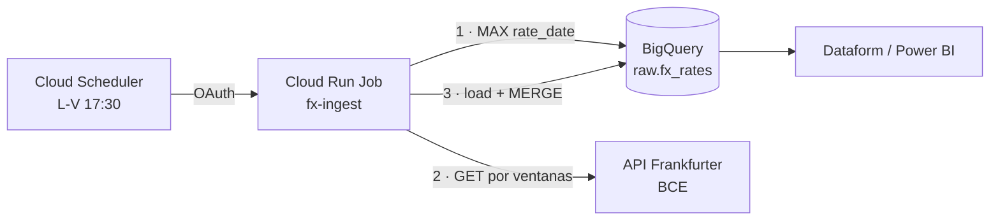

# REST API Ingestion · Python → BigQuery

[](https://github.com/adonaismarrero/fx-rates-ingestion/actions/workflows/ci.yml)


Ingesta **incremental e idempotente** de una API REST pública: los tipos de cambio de referencia
del **Banco Central Europeo** (vía [Frankfurter](https://frankfurter.dev), sin clave). Se ejecuta
a diario como **Cloud Run Job** y carga en **BigQuery**, o en local en un fichero **DuckDB** sin
necesidad de cuenta en la nube.

Es la pieza de ingesta que complementa a
[**gcp-dataform-terraform-pipeline**](https://github.com/adonaismarrero/gcp-dataform-terraform-pipeline)
y [**powerbi-sales-semantic-model**](https://github.com/adonaismarrero/powerbi-sales-semantic-model):
la tabla `raw.fx_rates` permite reportar las ventas en EUR en otras divisas.

> **English summary** — Production-style REST API ingestion in Python. Watermark-based
> incremental loads with a look-back window for late corrections, date-window "pagination",
> retries with exponential backoff, full jitter and `Retry-After` support, Pydantic data
> contracts, upserts on the primary key (DuckDB locally, staging table + `MERGE` in BigQuery),
> JSON logs, a non-root container and Terraform for a scheduled Cloud Run Job with
> least-privilege service accounts. CI runs ruff, strict mypy and pytest on Python 3.11–3.13.

---

## Arquitectura



Cada ejecución:

1. **Lee la marca de agua** (`MAX(rate_date)`) del propio destino: no hay ficheros de estado que
   se puedan desincronizar.
2. **Calcula el rango**: desde la marca de agua menos 7 días (*look-back*) hasta hoy. La fuente
   puede corregir datos recientes y el *upsert* hace que releerlos sea seguro.
3. **Divide el rango en ventanas** de 90 días (el equivalente a la paginación en esta API).
4. **Valida** cada respuesta con Pydantic y comprueba que llegan **todas** las divisas pedidas.
5. **Escribe con *upsert*** sobre la clave `(rate_date, base_currency, quote_currency)`.
6. **Emite un resumen** en JSON (filas, peticiones, marca de agua antes/después, duración).

## Decisiones de diseño

| Problema | Solución |
|---|---|
| Errores transitorios (5xx, 429, *timeouts*) | Reintentos con *backoff* exponencial y *full jitter*; respeta `Retry-After` con un tope. Los 4xx no se reintentan. |
| Reejecuciones y *backfills* | Carga idempotente: `INSERT … ON CONFLICT` en DuckDB, tabla *staging* + `MERGE` en BigQuery. Repetir una ejecución no duplica filas. |
| Correcciones tardías de la fuente | Ventana de *look-back* configurable (`--lookback-days`). |
| Si la ventana empieza en festivo, la API devuelve el día hábil anterior | Se descartan las fechas fuera de la ventana pedida, así cada ventana es independiente y determinista. |
| La API deja de devolver una divisa | La ejecución **falla** en lugar de cargar datos incompletos (de hecho detectó que el BCE no publica CLP). |
| Coste y rendimiento en BigQuery | Tabla particionada por `rate_date` y agrupada (*clustered*) por divisa. |
| Seguridad | Imagen sin root; dos cuentas de servicio: el job solo escribe en el dataset `raw`, el *scheduler* solo puede invocar el job. |
| Observabilidad | Logs JSON (Cloud Logging los interpreta) y código de salida ≠ 0 si falla, para que Cloud Run lo marque como error. |

## Uso en local

```bash
python -m venv .venv && source .venv/bin/activate      # Windows: .venv\Scripts\activate
pip install -e ".[dev]"

fx-ingest --start 2025-01-01            # primera carga  -> data/fx.duckdb
fx-ingest                                # siguientes: solo los últimos días
fx-ingest --dry-run --symbols USD,JPY    # valida sin escribir
```

Ejemplo real (primera carga y reejecución inmediata):

```text
primera:  8 ventanas · 8 peticiones · 2.886 filas  (6 divisas × 481 días hábiles)
segunda:  1 ventana  · 1 petición   ·    36 filas actualizadas, 0 duplicados
```

Todas las opciones admiten variable de entorno con prefijo `FX_` (`FX_SINK`, `FX_BQ_PROJECT`,
`FX_SYMBOLS`, `FX_LOOKBACK_DAYS`…), que es como se configura el contenedor.

## Despliegue en GCP

```bash
cd terraform
terraform init -backend-config=environments/dev.gcs.tfbackend
terraform apply -var-file=environments/dev.tfvars

docker build -t "$(terraform output -raw image)" ..
docker push "$(terraform output -raw image)"
gcloud run jobs execute fx-ingest --region europe-west1   # primera carga manual
```

Terraform crea: APIs, Artifact Registry (con limpieza de imágenes antiguas), dataset `raw`,
cuentas de servicio con permisos mínimos, el Cloud Run Job y la programación diaria.

## Calidad (CI)

| Job | Qué comprueba |
|---|---|
| Lint, types and tests | `ruff`, `mypy --strict` y `pytest` (cobertura ≥ 85 %) en Python 3.11, 3.12 y 3.13 |
| Container image | La imagen se construye y arranca |
| Terraform | `fmt` y `validate` |

Los tests simulan la API con `respx` (sin red) y cubren reintentos, `Retry-After`, errores no
reintentables, datos inválidos, la regla del día hábil anterior, idempotencia, correcciones,
*dry-run* y divisas ausentes.

## Estructura

```text
src/fx_ingest/
  client.py      cliente HTTP: timeouts, reintentos, backoff
  windows.py     ventanas de fechas y rango incremental
  models.py      contratos de datos (Pydantic)
  transform.py   respuesta -> filas, deduplicación
  sinks.py       DuckDB (local) y BigQuery (staging + MERGE)
  pipeline.py    orquestación y resumen de la ejecución
  cli.py         línea de comandos y logs JSON
tests/           pytest + respx
terraform/       Cloud Run Job, Scheduler, Artifact Registry, BigQuery, IAM
Dockerfile
```

## Licencia

[MIT](LICENSE). Datos: tipos de referencia del Banco Central Europeo, servidos por Frankfurter.
